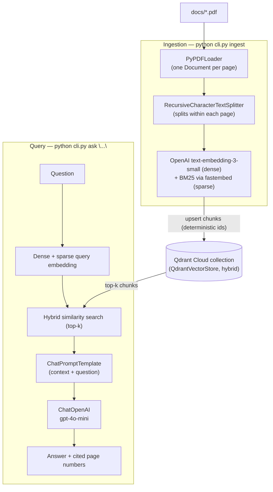
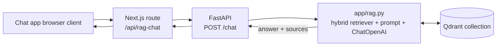

# PDF RAG with Qdrant + LangChain

Retrieval-augmented generation over the PDF(s) in `docs/`.

- **Chunking**: each PDF page is loaded as its own `Document` (`PyPDFLoader`), then
  `RecursiveCharacterTextSplitter` splits within each page — so chunks respect
  page boundaries and every chunk keeps its `page` metadata.
- **Embeddings**: OpenAI `text-embedding-3-small` (dense) + BM25 via `fastembed`
  (sparse), combined through `langchain-qdrant`'s hybrid retrieval mode.
- **Vector store**: Qdrant Cloud, via `QdrantVectorStore`.
- **Generation**: OpenAI, via `langchain-openai`'s `ChatOpenAI` (default `gpt-4o-mini`).

## Architecture



Both the CLI (`cli.py`) and the API (`app/server.py`) share the same `app/ingest.py` +
`app/rag.py` chunking + retrieval + generation logic.



## Setup

```bash
python3 -m venv .venv
source .venv/bin/activate
pip install -r requirements.txt
cp .env.example .env    # then fill in OPENAI_API_KEY, QDRANT_URL, QDRANT_API_KEY
```

`QDRANT_URL`/`QDRANT_API_KEY` come from a Qdrant Cloud cluster (cloud.qdrant.io).

## Usage

```bash
# Chunk docs/*.pdf and upsert into Qdrant (all PDFs in docs/ by default)
python cli.py ingest

# --recreate drops and rebuilds the collection first
python cli.py ingest --recreate

# Similarity search (raw retrieved chunks, no generation)
python cli.py search "revenue recognition policy"

# Ask a question (RAG: retrieve + generate)
python cli.py ask "What are the main risk factors disclosed in this filing?"
```

## Run as an API

The same retrieval + generation chain is also exposed over HTTP via FastAPI, so
other apps (e.g. a chat frontend) can call it:

```bash
uvicorn app.server:app --reload --port 8001
```

- `GET /health` — liveness check.
- `POST /chat` — body `{"messages": [{"role": "user", "content": "..."}]}`,
  returns `{"text": "...", "sources": [{"source": "...", "page": 3}, ...]}`.
  Only the last `user` message is used as the retrieval query.
- `POST /ingest` — multipart upload, field name `file` (PDF only, 25MB max).
  Saves the file into `docs/`, then chunks/embeds/upserts it, same as
  `python cli.py ingest`. Returns `{"filename", "pages", "chunks"}`. Re-uploading
  the same file overwrites its existing chunks (deterministic point ids) rather
  than duplicating them.

```bash
curl -X POST http://localhost:8001/chat \
  -H "Content-Type: application/json" \
  -d '{"messages":[{"role":"user","content":"What fiscal year does this filing cover?"}]}'

curl -X POST http://localhost:8001/ingest -F "file=@docs/some-report.pdf"
```

Set `CORS_ORIGINS` (comma-separated, default `http://localhost:3000`) to allow
the calling frontend's origin.

### Integration with my_test_chat_app

[my_test_chat_app](https://github.com/achyutasvm/my_test_chat_app) is a Next.js
chat app with a "Document Q&A" mode that can call **two** RAG backends —
this Qdrant service and the sibling
[vector_embeddings](https://github.com/achyutasvm/vector_embeddings) (Pinecone)
service — chosen per-upload via a selector in the UI. Run whichever backend(s)
you want available and set both `RAG_API_URL_QDRANT` (pointing here, default
port 8001) and `RAG_API_URL_PINECONE` (pointing at vector_embeddings, default
port 8000) in that app's `.env.local`.

```bash
# Terminal 1 — this service
cd path/to/langchain_qdrant_vectordb
source .venv/bin/activate
uvicorn app.server:app --reload --port 8001

# Terminal 2 — the Pinecone sibling service (optional, if you want both options)
cd path/to/vector_embeddings
source .venv/bin/activate
uvicorn app.server:app --reload --port 8000

# Terminal 3 — the chat app
cd path/to/my_test_chat_app
npm run dev
```

## Config

All settings are environment variables (see `.env.example`): OpenAI/Qdrant
credentials, collection name, embedding/generation models, chunk size/overlap,
and retrieval top-k.

## Project structure

- `app/config.py` — environment-variable configuration.
- `app/ingest.py` — PDF loading, chunking, embedding, and upsert into Qdrant.
- `app/rag.py` — hybrid retriever + prompt + generation chain, shared by the
  CLI and the API.
- `app/server.py` — FastAPI app (`/health`, `/chat`, `/ingest`).
- `cli.py` — CLI (`ingest`, `search`, `ask`) built on the same `app/` modules.
- `docs/` — source PDFs (also where uploaded files land).
